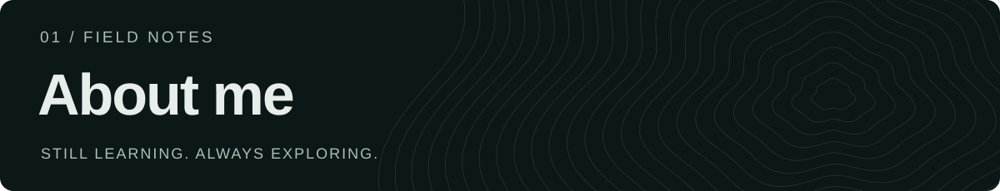
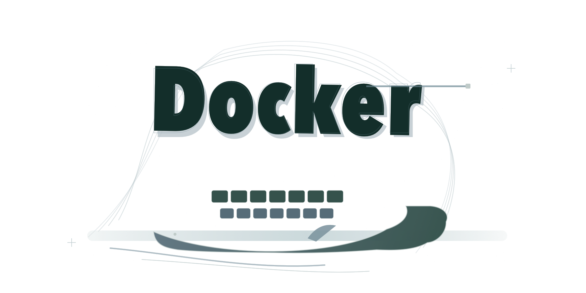
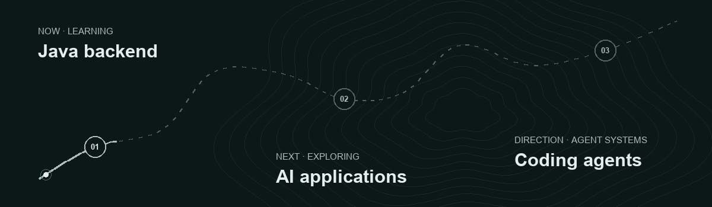
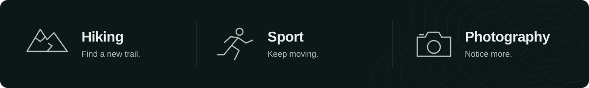

<picture>
  
</picture>

  <a href="#about-me">About</a> ·
  <a href="#development-trail">Trail</a> ·
  <a href="#featured-projects">Projects</a> ·
  <a href="#github-contributions">Contributions</a> ·
  <a href="#beyond-code">Beyond code</a> ·
  <a href="#connect">Connect</a>

## About me

<picture>
  
</picture>

I'm **Royee**, a second-year **Software Engineering student at the University of Southampton, UK**.

I'm learning **Java backend development**, building my foundations one step at a time. My direction is **AI applications**, with a particular interest in **Coding Agents and Agent Systems**.

Outside the editor, I enjoy hiking, sport and photography.

### Tools & tech stack

Tools I'm learning and exploring.

  
  
  

### Learning & exploring

  
  
  

## Development Trail

<picture>
  <source media="(max-width: 600px)" srcset="assets/trail-mobile.svg">
  <source media="(prefers-reduced-motion: reduce)" srcset="assets/trail.svg">
  
</picture>

Open a stage below to read more about the route.

<strong>01 · NOW — Java backend</strong>

Strengthening the fundamentals and learning by building. This is the current focus, with Java backend development as the active trail.

<strong>02 · NEXT — AI applications</strong>

Next, I want to explore how models and tools fit into useful software.

<strong>03 · DIRECTION — Coding Agents / Agent Systems</strong>

My longer-term direction is systems that can plan, use tools and assist with development.

## Featured Projects

<!-- PROJECTS: Add one verified, public repository owned by Royee-eng at a time. See MAINTAINING.md. -->

**The next waypoint is taking shape.**

I'll add projects here when they're ready to share and maintain.

[Browse my repositories →](https://github.com/Royee-eng?tab=repositories)

## GitHub Contributions

<a href="https://github.com/Royee-eng#js-contribution-activity-description">
  <picture>
    <source media="(max-width: 600px)" srcset="assets/contributions-mobile.svg?v=20261101200329">
    
  </picture>
</a>

[Explore the interactive calendar & activity ↓](https://github.com/Royee-eng#js-contribution-activity-description)

Last 26 weeks · Daily snapshot. Click the card to jump to GitHub's interactive calendar.

## Beyond Code

<picture>
  <source media="(max-width: 600px)" srcset="assets/beyond-mobile.svg">
  
</picture>

Trails, movement, and a camera — a few reasons to step away from the screen.

<!-- FIELD NOTES: Add your own photographs and route notes here when ready. -->

## Connect

  
  

---

Build things. Explore more. Keep learning.

