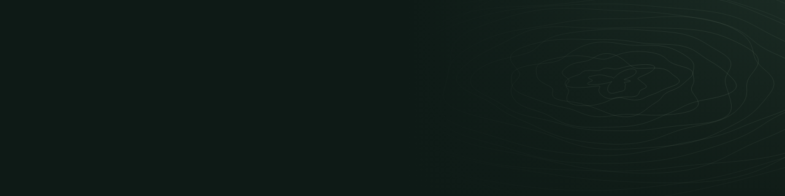

  
  <h1>Hi, I'm Royee 👋</h1>
  
<strong>Build things. Explore more.</strong>

  

    <code>🌲 Java Backend</code>
    <code>🏔️ AI Agent</code>
    <code>🥾 Hiking / Outdoors</code>
  

## ABOUT ME
### 🏫 University of Southampton | Software Engineering

<!-- 右侧装饰：山野等高线 -->

I build backend systems, and I'm learning to build agents — software that reads, decides and acts. Most of what I know came from reading source, breaking things, and going back out to the mountains to think about it.

### 🌱 Currently Exploring
- `Java Backend` : `Spring Boot` · `MySQL` · `Redis`
- `AI Agent` : `LLM Application` · `RAG` · `MCP`

### 💻 Connect With Me
- 🐙 GitHub : [Royee-eng](https://github.com/Royee-eng)
- 📫 E-mail : `18743004177@163.com`
- 🥾 LeetCode : [lucid-haslett2gl](https://leetcode.cn/u/lucid-haslett2gl)

 

<!-- 技术栈（自托管徽章） -->

  

<!-- 贪吃蛇贡献动画：由 GitHub Actions 每天自动生成 -->

  <picture>
    <source media="(prefers-color-scheme: dark)" srcset="https://raw.githubusercontent.com/Royee-eng/Royee-eng/output/github-contribution-grid-snake-dark.svg">
    <source media="(prefers-color-scheme: light)" srcset="https://raw.githubusercontent.com/Royee-eng/Royee-eng/output/github-contribution-grid-snake.svg">
    
  </picture>

