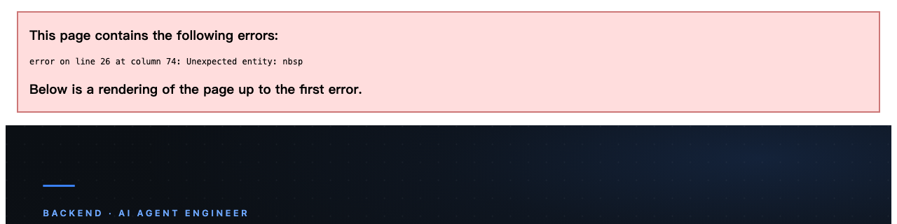

  

  <code>☕ Java Backend</code>
  <code>🤖 AI Agent</code>

## ABOUT ME
### 🏫 University of Southampton | Software Engineering

I build backend systems, and I'm learning to build agents — software that reads, decides and acts. Currently focused on Java backend engineering and AI agent development.

### 🌱 Currently Exploring
- `Java Backend` : `Spring Boot` · `MySQL` · `Redis`
- `AI Agent` : `LLM Application` · `RAG` · `MCP`

### 💻 Connect With Me
- 🐙 GitHub : [Royee-eng](https://github.com/Royee-eng)
- 📫 E-mail : `18743004177@163.com`
- 🧠 LeetCode : [lucid-haslett2gl](https://leetcode.cn/u/lucid-haslett2gl)

 

## 🧰 TECH STACK

  

<!-- 贪吃蛇贡献动画：由 GitHub Actions 每天自动生成 -->

  <picture>
    <source media="(prefers-color-scheme: dark)" srcset="https://raw.githubusercontent.com/Royee-eng/Royee-eng/output/github-contribution-grid-snake-dark.svg">
    <source media="(prefers-color-scheme: light)" srcset="https://raw.githubusercontent.com/Royee-eng/Royee-eng/output/github-contribution-grid-snake.svg">
    
  </picture>

