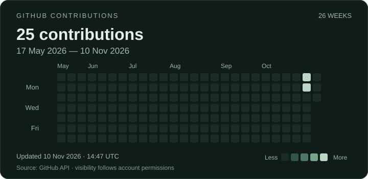

<picture>
  
</picture>

  <a href="#about-me">About</a> ·
  <a href="#development-trail">Trail</a> ·
  <a href="#featured-projects">Projects</a> ·
  <a href="#github-contributions">Contributions</a> ·
  <a href="#beyond-code">Beyond code</a>

## About me

I'm **Royee**, a second-year **Software Engineering student at the University of Southampton, UK**.

I'm learning **Java backend development**, building my foundations one step at a time. My direction is **AI applications**, with a particular interest in **Coding Agents and Agent Systems**.

Outside the editor, I enjoy hiking, sport and photography.

### Learning & exploring

  
  
  

These are my current learning interests, not claims of expertise.

## Development Trail

<picture>
  <source media="(max-width: 600px)" srcset="assets/trail-mobile.svg">
  <source media="(prefers-reduced-motion: reduce)" srcset="assets/trail.svg">
  
</picture>

- **Now · Java backend** — strengthen the fundamentals and learn by building.
- **Next · AI applications** — explore how models and tools fit into useful software.
- **Direction · Coding Agents / Agent Systems** — work towards systems that can plan, use tools and assist with development.

This is a direction of travel, not a completed checklist.

## Featured Projects

<!-- PROJECTS: Add one verified, public repository owned by Royee-eng at a time. See MAINTAINING.md. -->

**The next waypoint is taking shape.**

I'll add projects here when they're ready to share and maintain.

[Browse my repositories →](https://github.com/Royee-eng?tab=repositories)

## GitHub Contributions

[View live activity on GitHub →](https://github.com/Royee-eng?tab=overview)

## Beyond Code

Trails, movement, and a camera — a few reasons to step away from the screen.

<!-- FIELD NOTES: Add your own photographs and route notes here when ready. -->

---

Build things. Explore more. Keep learning.

